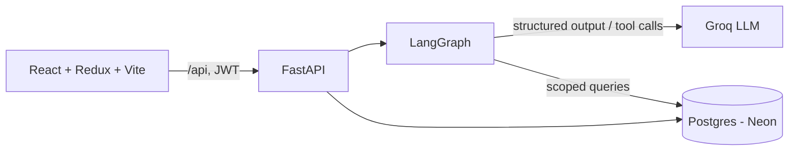
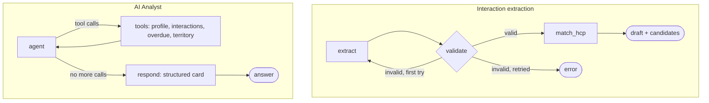

# OmniHealth CRM

An AI-first CRM for pharma field reps: log a visit in plain language, get a structured draft to review, and ask questions answered only from your own CRM data.

## The problem

Field reps lose hours re-typing visit notes into rigid forms, and managers can't see which doctors are going cold. Generic chatbots make things up. OmniHealth turns free-text notes into structured records you confirm, and its analyst only answers from data it reads through scoped tools.

## Features

- **Login and roles**: JWT auth (24h). Reps see their assigned HCPs and own activity; managers see the whole organization. Other organizations' data returns 404.
- **AI interaction logging**: notes go through a LangGraph pipeline (extract, validate with one retry, fuzzy-match the HCP). You edit the draft, then confirm to save. The model name and latency are shown.
- **AI Analyst chat**: a tool-calling agent that answers from your database (HCP profile, recent interactions, overdue follow-ups, territory summary), says when data is missing, and declines off-topic questions.
- **Dashboard**: HCP count, relationship health distribution, follow-ups due/overdue, today's visits, 30-day channel mix and coverage, and a ranked Next Best Actions queue with reasons built from stored data.
- **HCP directory**: search, filters, 360-degree drawer, add/edit/delete.
- **Follow-ups**: open/overdue/today/upcoming views, mark done, reschedule.
- **Manager view**: per-rep activity table (interactions, last activity, overdue follow-ups).
- **CSV export** of HCPs and interactions (respects your role), and a **command palette** (Cmd/Ctrl+K) that searches HCPs.
- **Hardening**: uniform error format with request ids, security headers, CORS allow-list, input validation, rate limits.

## Architecture



### LangGraph graphs



## Tech stack

React 19, Vite, Redux Toolkit, axios, Tailwind 4 | FastAPI, Pydantic 2, SQLAlchemy 2, Alembic | LangGraph, LangChain, Groq (`openai/gpt-oss-120b`) | Postgres (Neon) | Vercel (services)

## Demo credentials (after seeding)

| Role | Email | Password |
| --- | --- | --- |
| Rep | `rep@demo.com` | `Demo@123` |
| Manager | `manager@demo.com` | `Demo@123` |

The login page also has **Try demo (Rep)** and **Try demo (Manager)** buttons.

## Local setup

```bash
cd backend && python -m venv venv && venv/Scripts/pip install -r requirements.txt   # Windows; use venv/bin/pip on macOS/Linux
cp .env.example .env   # then fill DATABASE_URL, GROQ_API_KEY, JWT_SECRET
venv/Scripts/alembic upgrade head && venv/Scripts/python seed.py && venv/Scripts/uvicorn app.main:app --reload
cd ../frontend && npm install
npm run dev            # http://localhost:5173 (proxies /api to :8000)
```

Run tests: `cd backend && pip install -r requirements-dev.txt && pytest` (uses in-memory SQLite and a mocked LLM).

## Environment variables

| Variable | Where | Required | Purpose |
| --- | --- | --- | --- |
| `DATABASE_URL` | backend | yes | Postgres connection string |
| `GROQ_API_KEY` | backend | yes | Groq API key |
| `JWT_SECRET` | backend | yes | Token signing secret, 32+ chars |
| `MODEL_NAME` | backend | no | Default `openai/gpt-oss-120b` |
| `ALLOWED_ORIGINS` | backend | no | CORS origins, comma-separated (default `http://localhost:5173`) |
| `LOG_LEVEL` | backend | no | Default `INFO` |
| `DEMO_ORG_SLUG` | backend | no | Seed organization slug, default `demo` |
| `VITE_API_URL` | frontend | no | API base incl. `/api`; empty = same-origin |
| `VITE_DEV_API_TARGET` | frontend | no | Dev proxy target, default `http://localhost:8000` |

## Deploy

See [DEPLOY.md](DEPLOY.md) for Vercel setup, manual migrations and a 10-step checklist.

## Roadmap

- Mobile offline app
- GPS check-in
- Sample inventory
- Multi-org billing
